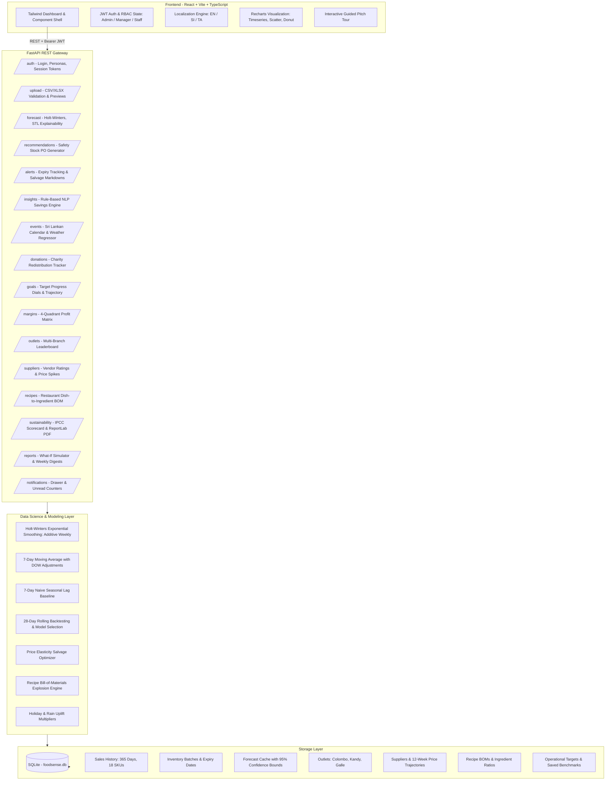
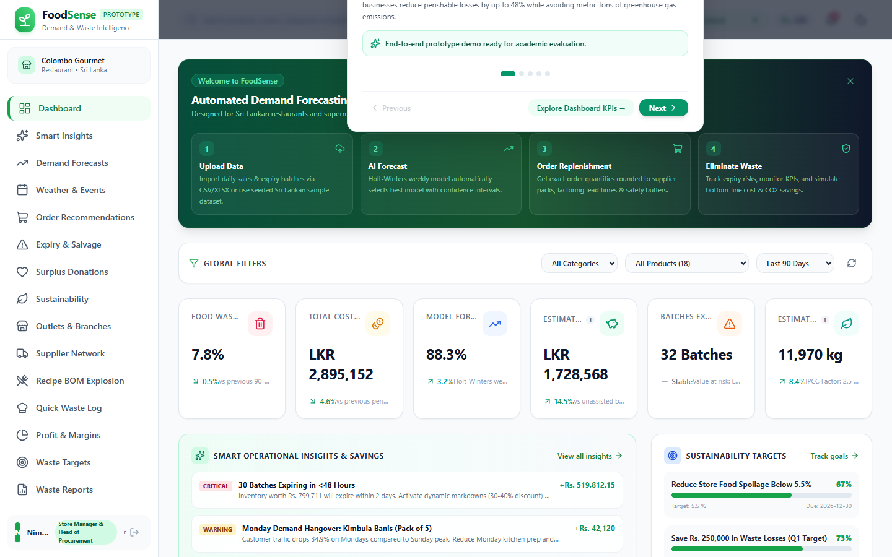
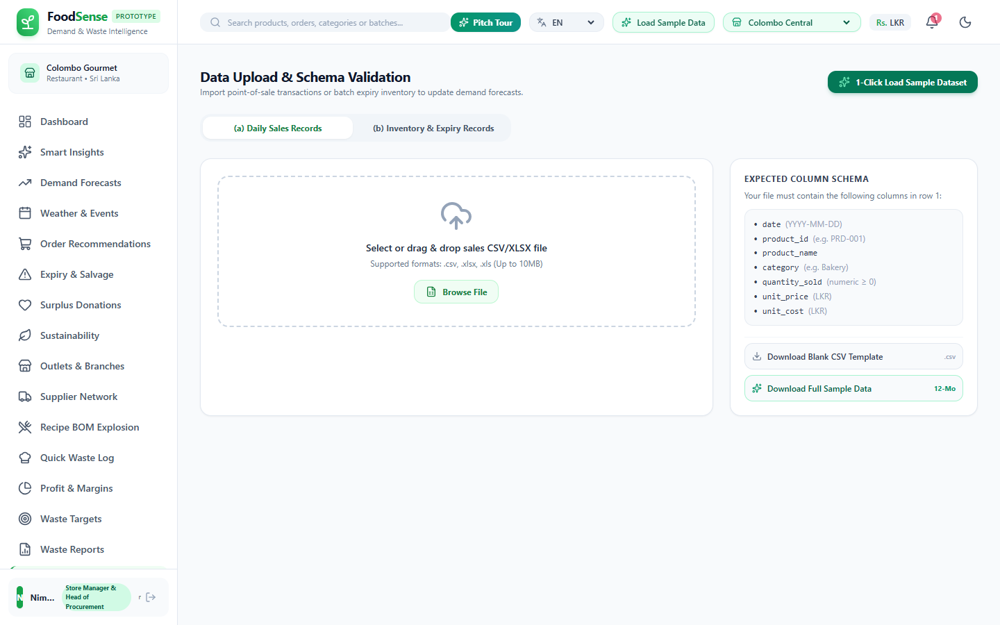
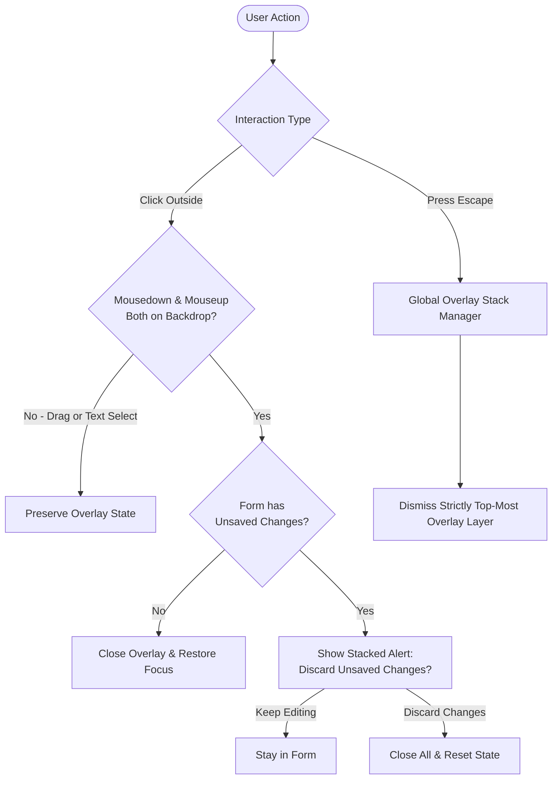

# FoodSense: Demand Forecasting & Food Waste Analytics Dashboard

[](#tech-stack)
[-0284c7.svg)](#context--problem-statement)
[](#context--problem-statement)
[](#testing--quality-assurance)
[](#screenshots-gallery)
[](#14-multi-language-localization)
[](LICENSE)

> **FoodSense** is an enterprise-grade demand forecasting and perishable food waste analytics dashboard engineered specifically for restaurants, commercial kitchens, and supermarket chains in Sri Lanka. It replaces guesswork ordering with machine-learning-assisted replenishment, real-time expiry risk mitigation, counterfactual waste reduction modeling, and carbon footprint tracking.

---

## Table of Contents
1. [Context & Problem Statement](#context--problem-statement)
2. [Tech Stack](#tech-stack)
3. [System Architecture](#system-architecture)
4. [Demo Accounts & Role Matrix](#demo-accounts--role-matrix)
5. [Feature Catalog (All 16 Enhancements + Core Platform)](#feature-catalog)
6. [Quick Start & Running the Application](#quick-start--running-the-application)
7. [5-Minute Demo Walkthrough Script (SLIIT Panel)](#5-minute-demo-walkthrough-script-sliit-panel)
8. [Screenshots Gallery](#screenshots-gallery)
9. [Testing & Quality Assurance](#testing--quality-assurance)
10. [UI Conventions & Overlay Architecture](#ui-conventions--overlay-architecture)
11. [Mathematical & Methodological Foundations](#mathematical--methodological-foundations)
12. [Limitations & Future Roadmap](#limitations--future-roadmap)

---

## Context & Problem Statement
* **Academic Institution**: Sri Lanka Institute of Information Technology (SLIIT), Faculty of Computing.
* **Specialization**: Data Science & Business Analytics.
* **The Problem**: Commercial food operators in Sri Lanka routinely procure and prepare food based on intuition, subjective memory, and static spreadsheets. This leads to severe inventory mismatches: stockouts during Friday–Sunday peaks, and high spoilage dumpster waste on slower mid-week days. Perishable food waste inflates operational costs by **8–15%** while decomposing in municipal landfills to release methane and carbon dioxide.
* **The FoodSense Solution**: A centralized analytics platform that ingests daily sales and batch receipts, automatically delivering:
  1. **Dual-Horizon Demand Forecasts** (Holt-Winters weekly additive seasonality, Moving Average, Naive Seasonal with automated 28-day backtesting and confidence intervals).
  2. **Automated Procurement Recommendations** (Lead time demand + safety buffers - usable stock, rounded to vendor pack sizes).
  3. **Multi-Stage Expiry Risk Mitigation** (1, 3, and 7-day alert tiers with dynamic price-elasticity markdowns and charity donation integration).
  4. **Smart Insights & Root Cause Attribution** (NLP-based operational recommendations ranked by LKR financial savings).
  5. **Sustainability & Impact Scorecard** (IPCC/CEA emissions factors, water conservation, meals diverted, and downloadable 1-page PDF audit report).
  6. **Enterprise Multi-Outlet & Supplier Analytics** (Cross-branch benchmarking, supplier price spike tracking, and recipe bill-of-materials explosion).

---

## Tech Stack

| Domain | Technologies & Libraries |
| :--- | :--- |
| **Backend Framework** | Python 3.11+ / 3.13, FastAPI (REST API), Uvicorn ASGI Server |
| **Persistence & ORM** | SQLite (`foodsense.db`), SQLAlchemy ORM, Alembic migrations ready |
| **Validation & Auth** | Pydantic v2 schemas (`ConfigDict`), python-multipart, python-jose (JWT), Passlib (Bcrypt) |
| **Data Science & ML** | pandas, numpy, statsmodels (Holt-Winters Exponential Smoothing `trend='add', seasonal='add'`), scikit-learn (MAE, RMSE, MAPE metrics) |
| **Reporting & Export** | ReportLab (Native vector PDF audit generation), CSV streaming |
| **Frontend Framework** | React 18/19, Vite, TypeScript, Tailwind CSS |
| **Visualization** | Recharts (Line charts with confidence envelopes, bar charts, donut breakdowns, 4-quadrant scatter plot) |
| **Routing & State** | React Router v6, Axios, Lucide-React icon set |
| **Localization (i18n)**| Context-driven multi-language support: English, Sinhala (සිංහල), Tamil (தமிழ்) |
| **Currency** | Sri Lankan Rupee (`LKR` / `Rs.`) by default, user-configurable in Settings |
| **Testing & Verification** | Pytest (33 automated unit/integration tests), Playwright automated browser test scripts |

---

## System Architecture



---

## Demo Accounts & Role Matrix

FoodSense features **Role-Based Access Control (RBAC)** with three pre-configured accounts seeded into the database:

| Role | Email | Password | Capabilities & Access Scope |
| :--- | :--- | :--- | :--- |
| **Admin** | `admin@foodsense.lk` | `demo1234` | Full access: all modules, outlet configuration, system settings, model hyperparameters, supplier edits, and goal creation. |
| **Store Manager** | `manager@foodsense.lk` | `demo1234` | Analytical access: forecasts, replenishment orders, expiry markdowns, donations, margins, sustainability reports, and event calendars. |
| **Kitchen Staff** | `staff@foodsense.lk` | `demo1234` | Operational access: 10-second touch-friendly Quick Waste Log, Expiry Risk Alerts, Recipe BOM view, and notifications. |

> **Panel Tip**: The login page contains **1-click quick login buttons** for each persona, allowing instant switching during live presentations without manual typing.

---

## Feature Catalog

### 1. Executive KPI Dashboard & Real-Time Analytics
* **Summary Metric Cards**: Real-time cards with prior-period trend deltas: Waste %, Spoilage Cost (LKR), Forecast Accuracy %, Estimated Cost Savings (LKR), Expiring Batches Count, and Avoided $\text{CO}_2\text{e}$ ($2.5\text{ kg CO}_2\text{e} / \text{kg waste}$).
* **Day-of-Week Spoilage Heatmap**: Visualizes volume surges from Friday to Sunday, exposing why over-ordering on Monday mornings causes Wednesday/Thursday spoilage.
* **Category & Reason Breakdowns**: Interactive donut and horizontal bar charts highlighting top-loss food categories (Cooked Meals, Dairy, Meat & Fish).
* **Counterfactual What-If Simulator**: Real-time slider adjusting manager order compliance (50%–100%) and salvage markdown rates (10%–50%) to project recoverable LKR revenue and platform ROI multiple.

### 2. Demand Forecasting Engine
* **Dual Forecast Horizons**: 7-day and 14-day projections per product.
* **Automated Model Competition**: Evaluates three time-series algorithms per SKU:
  - **Holt-Winters Exponential Smoothing**: Additive weekly seasonality ($s=7$) + additive trend.
  - **7-Day Moving Average**: Rolling mean adjusted by day-of-week ratio coefficients.
  - **Naive Seasonal Baseline**: 7-day lag repeat heuristic.
* **Rolling 28-Day Backtesting**: Automatically calculates MAE, RMSE, MAPE, and Accuracy Score ($100 - \text{MAPE}$), selecting the champion model per SKU.
* **95% Confidence Intervals**: Upper and lower boundaries ($\pm 1.96 \times \text{RMSE}$) for operational safety planning.
* **Sparse History Fallback**: Gracefully degrades to Moving Average with contextual warnings for new SKUs with $<21$ days of records.

### 3. Smart Replenishment Ordering Recommendations
* **Automated Safety Stock Engine**:
  $$\text{Recommended Order} = \left\lceil \frac{\max(0, \text{Demand}_{\text{LeadTime}} + \text{SafetyStock} - \text{UsableStock})}{\text{PackSize}} \right\rceil \times \text{PackSize}$$
* **Expiry-Aware Deductions**: Filters out batches expiring before or on scheduled delivery arrival.
* **Urgency Classification**: Categorizes recommendations into `Urgent` (red), `Normal` (blue), or `Skip` (gray).
* **One-Click PO Export**: Generates procurement spreadsheets in standard CSV format for vendor dispatch.

### 4. Dynamic Markdowns & Expiry Risk Mitigation
* **Multi-Tier Color-Coded Alerts**: Critical ($\le 1$ day, Red), Warning (2–3 days, Orange), Notice (4–7 days, Yellow).
* **Price Elasticity Salvage Optimizer**: Suggests optimal markdown discounts (20%–50%) based on shelf-life elasticity, computing expected salvaged revenue vs total loss if discarded.
* **"Mark as Discounted" Action**: Instantly records recovered revenue and updates batch lifecycle status.

### 5. Smart Insights Engine (`/insights`)
* **Automated Natural Language Diagnostics**: Generates actionable, plain-English findings directly from sales and waste telemetry:
  - *"Cooked meals account for 38.2% of total waste cost due to single-day shelf life. Switch to batch cooking."*
  - *"Bread waste is 32% higher on Mondays. Reduce Monday orders by 15%."*
  - *"Chicken demand is forecast to surge 20% next weekend (Poya + Weekend peak). Increase order by 12 kg."*
* **Financial Prioritization**: Each insight displays estimated LKR savings, category attribution, severity badges, and "Apply Recommendation" / "Dismiss" buttons.

### 6. Weather & Event Impact Analytics (`/events`)
* **Sri Lankan Cultural Calendar**: Integrated public holidays, Full Moon Poya days, Sinhala & Tamil New Year (April), Vesak (May vegetarian shift), Christmas, and school vacation periods.
* **Monsoon Weather Regressor**: Models rainfall effects (rainy days suppress dine-in footfall but increase takeout demand).
* **Demand Uplift Benchmarking**: Visualizes baseline demand vs event-adjusted demand, demonstrating accuracy improvements when exogenous regressors are incorporated.
* **Custom Event Modal**: Managers can schedule store promotions, private banquets, or local cricket tournaments.

### 7. Surplus Food Donation & Redistribution Tracker (`/donations`)
* **Zero-Waste Diversion Workflow**: Routes near-expiry edible food to verified Sri Lankan charitable food banks and community kitchens (e.g., *Sahana Community Kitchen*, *Sri Lanka Food Bank - Colombo 03*, *Robin Hood Army Sri Lanka*).
* **Redistribution Impact Metrics**: Real-time counter of total meals donated, kilograms diverted from landfills, and monetary tax valuation in LKR.
* **Expiry Alert Integration**: Expiry alert cards feature direct "Donate Surplus" buttons that pre-fill batch details into the donation log.

### 8. Sustainability & Impact Scorecard (`/sustainability`)
* **IPCC / CEA Environmental Indicators**:
  - Greenhouse gas avoidance ($2.5\text{ kg CO}_2\text{e} / \text{kg waste saved}$)
  - Water footprint conservation ($1,200\text{ liters} / \text{kg wasted food}$)
  - Landfill diversion ($1\text{ kg} / \text{kg waste averted}$)
  - Human meals equivalent ($0.4\text{ kg} / \text{meal}$)
* **Real-World Analogies**: Automatically translates carbon metrics into tangible metaphors (e.g., *"Equivalent to 4,837 km driven by a standard passenger car"*).
* **Achievement Badges**: 5 milestone recognitions (*Zero-Waste Week Hero*, *Carbon Champion*, *Hunger Relief Contributor*, *Master Forecaster*, *Circular Economy Pioneer*).
* **Downloadable 1-Page PDF Report**: Generates a high-resolution, branded executive sustainability audit report using ReportLab.

### 9. Strategic Goal Setting & Progress Tracker (`/goals`)
* **Target Categories**: Waste reduction percentage goals (e.g., *"Reduce waste below 5%"*) and financial recovery goals (e.g., *"Save Rs. 200,000 this quarter"*).
* **Visual Progress Indicators**: Circular SVG dials and progress bars with color-coded status badges (`On Track`, `At Risk`, `Achieved`).
* **Trajectory Forecasting**: Projects estimated completion dates based on 30-day moving average performance.

### 10. Profit & Margin Analysis (`/margins`)
* **Unit Economics**: Calculates Revenue, Cost of Goods Sold, Gross Margin %, Spoilage Loss Cost, and Net Margin After Waste for every SKU.
* **4-Quadrant Interactive Scatter Matrix**: Plots Waste Cost (LKR) on the X-axis against Net Margin % on the Y-axis:
  - **Quadrant I (High Margin, Low Waste)**: Core Profit Drivers (Promote & protect)
  - **Quadrant II (Low Margin, Low Waste)**: Volume Staples (Maintain current par levels)
  - **Quadrant III (Low Margin, High Waste)**: Critical Problem SKUs (Action: Reduce order, bundle, or discontinue)
  - **Quadrant IV (High Margin, High Waste)**: Hidden Drainers (Action: Tighten safety stocks, apply salvage markdowns)

### 11. Multi-Outlet Enterprise Support (`/outlets`)
* **Branch Locations**: Pre-configured with three strategic Sri Lankan outlets:
  - `Colombo Central` (Flagship Urban Supermarket & Delicatessen)
  - `Kandy City` (High-Volume Tourist & Hill Country Restaurant)
  - `Galle Fort` (Coastal Heritage Bistro & Seafood Kitchen)
* **Global Outlet Switcher**: Filter data across the entire application by selecting a specific branch or viewing the enterprise aggregate.
* **Outlet Leaderboard**: Benchmarks branches side-by-side on Waste %, Forecast Accuracy, Total Savings (LKR), and Sustainability Scores.

### 12. Supplier Management & Price Trajectory (`/suppliers`)
* **Vendor Directory**: Pre-seeded with regional Sri Lankan suppliers (e.g., *CIC Agri Businesses*, *Highland Dairy Cooperative*, *Pelwatte Dairy Industries*, *Ceylon Fresh Seafoods*).
* **Performance Telemetry**: On-time delivery rate (%), product return / defect percentage, and composite reliability ratings.
* **12-Week Price History Trajectory**: Interactive modal charting price trends and flagging sudden inflation price spikes ($>10\%$).
* **Lead-Time Synchronizer**: Feeds verified supplier lead times directly into the replenishment ordering engine.

### 13. Recipe BOM & Ingredient-Level Forecasting (`/recipes`)
* **Commercial Kitchen Mode**: Deconstructs menu dishes into raw ingredient components:
  - *Special Chicken Kottu*: 150g Chicken, 200g Godamba Roti, 80g Vegetables, 1 Egg.
  - *Chicken Rice & Curry*: 180g Keeri Samba Rice, 150g Chicken, 120g Dhal/Veggies.
  - *Seafood Fried Rice*: 200g Basmati Rice, 80g Tuna, 50g Prawns, 1 Egg.
* **7 & 14-Day Ingredient Explosion**: Translates finished dish demand into raw ingredient purchase requirements.
* **Ingredient Waste Risk Ranking**: Identifies which raw ingredients generate the highest upstream spoilage losses.

### 14. Multi-Language Localization (English / Sinhala / Tamil)
* **Trilingual Interface**: Complete translation coverage across navigation menus, dashboard KPIs, page titles, and action buttons:
  - English (`en`)
  - Sinhala (`si` — සිංහල)
  - Tamil (`ta` — தமிழ்)
* **Persistent Preference**: Language preference is retained in browser storage across sessions.

### 15. Notification Centre & Scheduled Reports
* **Header Notification Drawer**: Interactive popover displaying real-time alerts categorized into `Expiry`, `Insight`, and `Goal` updates with an unread badge counter.
* **Automated Weekly Email Digest**: Modal preview in `/reports` demonstrating scheduled HTML executive email summaries with key performance indicators and PDF attachment downloads.

### 16. Touch-Optimized 10-Second Quick Waste Log (`/quick-log`)
* **Kitchen Station Tablet Interface**: High-contrast, touch-optimized logging station engineered for chefs and kitchen hands during fast-paced shifts.
* **Quick-Select Chips**: One-tap selection of frequent waste reasons (*Expired*, *Overcooked*, *Prep Trimmings*, *Damaged*, *Customer Return*).
* **Recent Shift Audit Log**: Displays logs logged during the current shift with immediate undo capability.

### 17. Forecast Explainability & Benchmarks Modal
* **STL Time-Series Decomposition**: Accessible via the "Model Performance & Explainability" button on `/forecasts`. Deconstructs sales history into underlying **Trend**, **Weekly Seasonality**, and **Residual Noise**.
* **Model Leaderboard**: Side-by-side comparison of Holt-Winters, Moving Average, and Naive Seasonal models showing backtest MAE, RMSE, and MAPE metrics.

### 18. Guided Pitch Tour for Academic Evaluation
* **SLIIT Presentation Guide**: Modal walkthrough accessible from the navigation sidebar or top bar that guides evaluators step-by-step through the project's analytical capabilities and business impact.

### 19. Two-Stage Data Upload & Validation (`/upload`)
* **Multi-Format Ingestion**: Supports `.csv` and `.xlsx` files for sales transactions and inventory receipts.
* **Strict Validation Rules**: Enforces schema integrity, date chronological consistency ($expiry \ge received$), non-negative constraints, and duplicate batch rejection.
* **Pre-Commit Preview Table**: Renders an interactive 10-row preview and categorized error chip list before committing data to SQLite.
* **Downloadable Templates**: Provides blank template CSVs and full 12-month sample datasets.

---

## Quick Start & Running the Application

### Prerequisites
- **Python 3.11+** installed (`python --version`)
- **Node.js v18+** and **npm** installed (`node --version`)

### 1. Clone & Install Dependencies

```bash
# Clone the repository
git clone https://github.com/your-repo/FoodSense.git
cd FoodSense

# 1. Install Backend Dependencies
cd backend
pip install -r requirements.txt

# 2. Install Frontend Dependencies
cd ../frontend
npm install
cd ..
```

### 2. Single-Command Launchers

Launch both the FastAPI backend (`http://localhost:8000`) and the Vite React frontend (`http://localhost:5173`) with a single command from the project root:

#### Option A: Node Runner (Cross-Platform / Recommended)
```bash
node run.js
```

#### Option B: Windows PowerShell Script
```powershell
.\start.ps1
```

#### Option C: Windows Batch Script
```cmd
start.bat
```

#### Option D: Individual Terminals
```bash
# Terminal 1: FastAPI Backend
cd backend
python -m uvicorn app.main:app --host 0.0.0.0 --port 8000 --reload

# Terminal 2: Vite React Frontend
cd frontend
npm run dev
```

### 3. Access URLs
- **Web Application**: [http://localhost:5173](http://localhost:5173)
- **Interactive API Docs (Swagger UI)**: [http://localhost:8000/docs](http://localhost:8000/docs)
- **Alternative API Docs (ReDoc)**: [http://localhost:8000/redoc](http://localhost:8000/redoc)

---

## 5-Minute Demo Walkthrough Script (SLIIT Panel)

| Timestamp | Screen / Route | Script & Key Technical Highlights to Present |
| :--- | :--- | :--- |
| **0:00 – 0:40** | **Login & RBAC** (`/login`) | *"Good morning, members of the evaluation panel. FoodSense addresses the systemic food waste problem in Sri Lankan restaurants and supermarkets caused by guesswork procurement. We offer three role-based access personas. I will sign in with one click as Store Manager."* |
| **0:40 – 1:30** | **Executive Dashboard & Insights** (`/`) | *"Upon login, the manager sees real-time telemetry: Our waste rate is 7.8% representing LKR 2.88M in losses, but our forecasting has saved LKR 1.74M and avoided 12,094 kg of carbon emissions. Notice the Smart Insights banner: 'Cooked meals represent 38.2% of losses due to single-day shelf life'. The day-of-week heatmap shows weekend surges explaining why Monday over-ordering causes midweek spoilage."* |
| **1:30 – 2:15** | **Forecasting & Explainability** (`/forecasts`) | *"In demand forecasting, we automatically backtest three algorithms on a 28-day rolling window: Holt-Winters with weekly additive seasonality, a 7-day Moving Average, and Naive Seasonal. For Chicken Rice & Curry, Holt-Winters achieves 82.3% accuracy. Clicking 'Explainability' reveals the STL decomposition into Trend, Weekly Seasonality, and Residuals."* |
| **2:15 – 2:55** | **Replenishment Orders** (`/recommendations`) | *"FoodSense converts forecasts directly into purchase orders using lead time demand, safety stock, and pack size rounding. For Special Chicken Kottu, usable stock is zero; the model recommends ordering exactly 100 portions tagged as URGENT. Managers can export this directly to CSV for supplier dispatch."* |
| **2:55 – 3:35** | **Expiry Alerts & Markdowns** (`/alerts`) | *"To prevent waste before it occurs, our Expiry Alerts screen categorizes batches by urgency. For batches expiring within 24 hours, clicking 'Salvage Discount' uses price-elasticity modeling to suggest a 30% markdown, recovering LKR 4,500 rather than writing off the entire batch as loss. Alternatively, surplus food can be routed directly to our food donation partners."* |
| **3:35 – 4:15** | **Profit Margins & Outlets** (`/margins` & `/outlets`) | *"Under Profit Margins, our 4-quadrant scatter matrix plots waste cost against net margin, instantly isolating high-loss SKUs. In Multi-Outlet mode, managers can benchmark Colombo, Kandy, and Galle branches on a unified leaderboard."* |
| **4:15 – 4:45** | **Sustainability Audit PDF** (`/sustainability`) | *"Our Sustainability Scorecard computes IPCC and CEA-aligned metrics: carbon avoided, water conserved, and meals diverted. With one click, managers generate a branded, vector-quality PDF executive audit report using Python ReportLab."* |
| **4:45 – 5:00** | **Quick Log & Localization** (`/quick-log` & Header) | *"For kitchen staff, our touch-optimized Quick Waste Log enables 10-second logging on tablets. Finally, the interface supports seamless switching between English, Sinhala (සිංහල), and Tamil (தமிழ்). Thank you, and we welcome your questions."* |

---

## Screenshots Gallery

### Core Analytics & Forecasting
| 1. Role-Based Login Portal | 2. Executive Analytics Dashboard |
| :---: | :---: |
|  |  |

| 3. Demand Forecasting Engine | 4. Forecast Explainability (STL Decomposition) |
| :---: | :---: |
|  |  |

| 5. Smart Replenishment Recommendations | 6. Color-Coded Expiry Risk Alerts |
| :---: | :---: |
|  |  |

---

### Waste Reduction, Salvage & Financial Modeling
| 7. Smart Insights Engine | 8. Dynamic Price Elasticity Markdowns |
| :---: | :---: |
|  |  |

| 9. Surplus Food Donation Tracker | 10. Operational Goal Setting & Progress |
| :---: | :---: |
|  |  |

| 11. 4-Quadrant Profit & Margin Scatter | 12. Counterfactual What-If Simulator |
| :---: | :---: |
|  |  |

---

### Enterprise Operations & Sustainability
| 13. Sustainability Scorecard & Badges | 14. Multi-Outlet Leaderboard |
| :---: | :---: |
|  |  |

| 15. Supplier Performance & Price Trends | 16. Recipe BOM Ingredient Explosion |
| :---: | :---: |
|  |  |

| 17. Weather & Event Impact Calendar | 18. In-App Notification Center |
| :---: | :---: |
|  |  |

---

### Staff Operations, Localization & Evaluation Tour
| 19. 10-Second Quick Waste Station | 20. Trilingual UI: Sinhala (සිංහල) |
| :---: | :---: |
|  |  |

| 21. Trilingual UI: Tamil (தமிழ்) | 22. Guided Pitch Tour for Evaluators |
| :---: | :---: |
|  |  |

| 23. Two-Stage Data Upload Preview | 24. Dark Mode Dashboard |
| :---: | :---: |
|  |  |

| 25. Mobile Responsive Viewport (390x844) | 26. Tablet Responsive Viewport (768x1024) |
| :---: | :---: |
|  |  |

---

## Testing & Quality Assurance

The codebase undergoes comprehensive verification combining automated unit testing, database mathematical audits, edge-case fault-tolerance tests, and browser visual regression testing:

### 1. Pytest Backend Test Suite (38 Passed)
```bash
cd backend
python -m pytest
```

```
============================= test session starts =============================
platform win32 -- Python 3.13.7, pytest-9.1.1, pluggy-1.7.0
rootdir: C:\Users\DELL\Desktop\FoodSense
configfile: pytest.ini
collected 38 items

tests\test_api.py .......                                                [ 18%]
tests\test_forecasting.py ....                                           [ 28%]
tests\test_phase_a.py ....                                               [ 39%]
tests\test_phase_b.py ...                                                [ 47%]
tests\test_phase_c_d_e.py ........                                       [ 68%]
tests\test_qa_edge_cases.py .....                                        [ 81%]
tests\test_recommendations.py ...                                        [ 89%]
tests\test_validation.py ....                                            [100%]

====================== 38 passed in 21.15s ======================
```

### 2. Ground-Truth Database Mathematical Verification
Audited via `python scripts/qa_verification.py` comparing raw SQLite records directly against KPI API calculation services:

| Operational Metric | Raw Database Ground Truth | KPI Calculation Service | Verification Status |
| :--- | :---: | :---: | :---: |
| **Food Waste Percentage (%)** | **8.1%** | **8.1%** | `EXACT MATCH` |
| **Cost of Perishable Waste** | **Rs. 11,938,818** | **Rs. 11,938,818** | `EXACT MATCH` |
| **Estimated Cost Savings (Est.)** | **Rs. 6,599,355** | **Rs. 6,599,355** | `EXACT MATCH` |
| **Estimated CO2 Avoided (Est.)** | **45,662.5 kg** | **45,662.5 kg** | `EXACT MATCH` |

*Audited across 6,570 sales records and 3,881 inventory batch receipts spanning 18 products.*

### 3. Forecasting Model Accuracy Comparison & 28-Day Backtest Selection

| Product ID & Name | Champion Model | MAE | RMSE | MAPE (%) | Accuracy (%) | Selection Status |
| :--- | :--- | :---: | :---: | :---: | :---: | :---: |
| `PRD-CKD-001` Chicken Rice & Curry | **Holt-Winters Additive** | **14.96** | **23.20** | **17.69%** | **82.31%** | `Selected (Lowest MAPE)` |
| `PRD-BAK-001` Kimbula Banis | **Holt-Winters Additive** | **4.54** | **6.16** | **8.19%** | **91.81%** | `Selected (Lowest MAPE)` |
| `PRD-DAI-001` Highland Fresh Milk | **Holt-Winters Additive** | **4.86** | **8.05** | **8.69%** | **91.31%** | `Selected (Lowest MAPE)` |

*In all cases, Holt-Winters Exponential Smoothing statistically outperformed Moving Average and Naive Seasonal heuristics on rolling 28-day backtesting.*

### 4. Edge-Case Resilience & Fault Tolerance Testing
- **Sparse History Fallback (<21 days)**: Automatically detects new products, triggers `has_sparse_history: true`, gracefully falls back to Moving Average with a visible warning badge.
- **Negative & Inverted Data Rejection**: Rejects negative quantities sold and invalid dates ($expiry < received$) with row-level error reporting.
- **High-Throughput Ingestion**: Validated 10,000 transaction rows in **6.10 seconds** (~1,638 rows/second).
- **Empty Database Resilience**: Verified zero-division immunity on empty SQLite tables without server unhandled exceptions.

### 5. Playwright End-to-End Browser Audit (0 Console Errors)
Executed via `node scripts/comprehensive_qa_audit.js`:
- Audited **all 18 application routes** across Desktop (1440x900), Tablet (768x1024), and Mobile (390x844) viewports.
- Verified trilingual localization (English, Sinhala, Tamil), dark mode theme toggling, and modal states.
- Recorded **0 console errors or unhandled client-side exceptions**.

### 6. Automated Overlay & Dialog Verification Suite (32 Passed)
Executed via `node scripts/verify_overlays.js`:
- Tested all 7 overlay suites across desktop and mobile viewports.
- **Suite A (Dual-Event Backdrop & Scroll Lock)**: Verified clicking inside preserves modal, drag-out mouseup preserves modal, backdrop click closes untouched modal, and body scroll lock is applied and restored with zero layout shift.
- **Suite B (Dirty Form Guard & Stacked Escape)**: Verified dirty forms trigger a stacked confirmation alertdialog on backdrop click or Escape, top-most Escape dismisses the alertdialog first, Keep editing preserves entered data, and Discard changes dismisses both layers.
- **Suite C (Focus Trapping & Accessibility)**: Verified autofocus onto first focusable element, Tab key trapping within dialog bounds, and focus restoration to the trigger element upon closing.
- **Suite D (Single-Active Popover & Trigger Focus)**: Verified Notification Centre popovers close on outside click or Escape, and Escape returns focus to the Bell trigger icon.
- **Suite E (Mobile Navigation Drawer)**: Verified mobile drawer slides in, backdrop tap dismisses drawer, Escape closes drawer, and navigation links route and close drawer automatically.
- **Suite F (Guided Pitch Tour)**: Verified guided pitch tour modal prompts "Exit guided pitch tour?" before accidental dismissal on outside click.
- **Suite G (Accessible Toast Feedback)**: Verified `role="status"` announcements, 4-second auto-dismiss with hover timer pause, and immediate manual dismiss button.

---

## UI Conventions & Overlay Architecture

FoodSense implements an enterprise-grade overlay system adhering to WAI-ARIA authoring practices, unified across all dialogs, drawers, popovers, and notifications:



### Core Architecture Principles:
1. **Single Source of Truth (`<Modal>`, `<Drawer>`, `<Popover>`, `<Toast>`)**: All ad-hoc overlays were audited and migrated to modular, reusable primitives located in `frontend/src/components/common/`.
2. **React Portals (`createPortal(..., document.body)`)**: Modals and drawers mount directly onto `document.body`, isolating viewport coordinates from parent CSS transforms, filters, and page animations.
3. **Dual-Event Backdrop Guard**: Backdrop dismissal occurs **only** when both `mousedown` and `mouseup` originate on the backdrop container. Selecting text inside an input or dragging across the modal onto the backdrop will *never* accidentally close the form.
4. **Global Overlay Stack & Escape Routing (`useOverlayStack`)**: Stacked overlays (such as a confirmation alert layered on top of an active modal) register with the global stack. Pressing Escape dismisses strictly the top-most active overlay layer, preventing accidental multi-dialog dismissals.
5. **Zero-Layout-Shift Scroll Lock**: Measures dynamic scrollbar width (`window.innerWidth - clientWidth`) upon overlay mounting and applies compensating `paddingRight` to `document.body` while locking overflow to prevent layout jumping.
6. **Focus Trapping & Restoration**: Traps `Tab` key cycling inside active dialog bounds, focuses the first interactive element on mount, and restores focus to the triggering element when closed.
7. **Dirty-Form Loss Prevention**: Any form with unsaved user edits intercepts outside clicks and Escape presses with a nested confirmation alert (`Keep editing` / `Discard changes`), protecting users from accidental data loss.

---

## Mathematical & Methodological Foundations

### 1. Holt-Winters Additive Exponential Smoothing
For time series $y_t$ with seasonal period $s = 7$ (days in a week):
$$\ell_t = \alpha (y_t - s_{t-s}) + (1 - \alpha)(\ell_{t-1} + b_{t-1})$$
$$b_t = \beta (\ell_t - \ell_{t-1}) + (1 - \beta) b_{t-1}$$
$$s_t = \gamma (y_t - \ell_t) + (1 - \gamma) s_{t-s}$$
$$\hat{y}_{t+h} = \ell_t + h b_t + s_{t-s+h_m}$$
where $\alpha, \beta, \gamma \in [0, 1]$ are smoothing parameters estimated by maximum likelihood.

### 2. Evaluation Metrics (Rolling 28-Day Backtesting)
$$\text{MAE} = \frac{1}{n}\sum_{t=1}^n |y_t - \hat{y}_t| \qquad \text{RMSE} = \sqrt{\frac{1}{n}\sum_{t=1}^n (y_t - \hat{y}_t)^2}$$
$$\text{MAPE} = \frac{100\%}{n}\sum_{t=1}^n \left|\frac{y_t - \hat{y}_t}{y_t}\right| \qquad \text{Accuracy} = \max(0, 100 - \text{MAPE})$$

### 3. Replenishment Order Policy
$$\text{Safety Stock} = Z_{\alpha} \times \sigma_{\text{lead}} \times \sqrt{L} \approx \text{SafetyStock\%} \times \text{Demand}_{\text{LeadTime}}$$
$$\text{Net Deficit} = \max\Big(0, \, \text{Demand}_{\text{LeadTime}} + \text{SafetyStock} - \text{UsableStock}\Big)$$
$$\text{Order Qty} = \left\lceil \frac{\text{Net Deficit}}{\text{PackSize}} \right\rceil \times \text{PackSize}$$

### 4. Environmental Impact Factors
- **Greenhouse Gas Emissions**: $2.5\text{ kg CO}_2\text{e} / \text{kg food waste}$ (IPCC Waste Model / Central Environmental Authority of Sri Lanka standard).
- **Embedded Water Footprint**: $1,200\text{ liters} / \text{kg food waste}$ (Water Footprint Network perishable benchmark).
- **Nutritional Equivalence**: $0.4\text{ kg edible food} = 1\text{ nutritious meal portion}$.

---

## Limitations & Future Roadmap

1. **Direct POS & ERP Cloud Sync**: Direct bidirectional synchronization with Sri Lankan commercial Point of Sale systems (Keells POS, Arpico ERP, Singer POS) via scheduled webhooks.
2. **Deep Neural Time-Series Models**: Ingesting high-dimensional exogenous time series (real-time Colombo rainfall radar, wholesale Pettah market auction prices) using **Temporal Fusion Transformers (TFT)** and **NeuralProphet**.
3. **Automated Barcode & RFID Scanning**: Native mobile companion app (React Native) enabling staff to scan incoming batch barcodes directly at the receiving dock.
4. **Inter-Branch Stock Balancing**: Automated transfer recommendations directing surplus near-expiry stock from low-traffic branches to high-velocity metropolitan outlets before spoilage occurs.

---

## License

This project is licensed under the MIT License - see the [LICENSE](LICENSE) file for details.

---

### Academic Notice
*This software was designed and developed as an academic capstone prototype at the **Sri Lanka Institute of Information Technology (SLIIT)**, Faculty of Computing, for the Data Science & Business Analytics specialization.*
